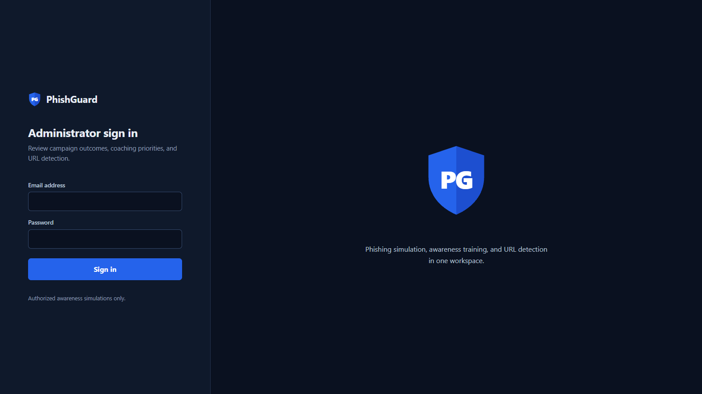
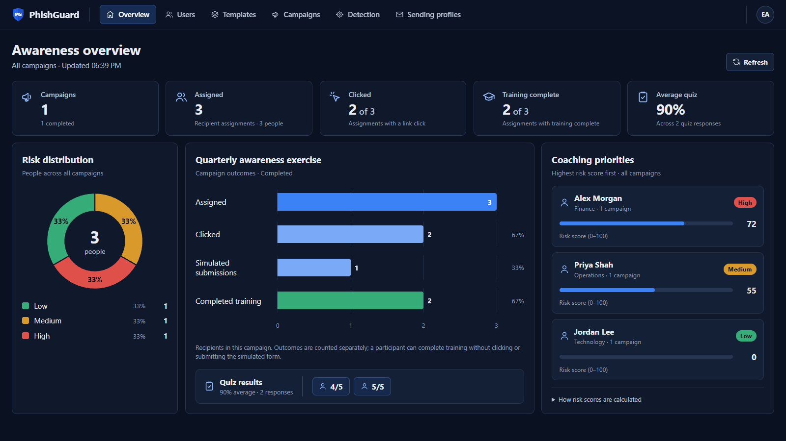
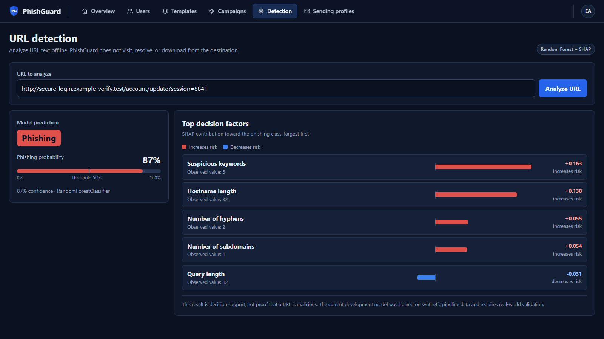
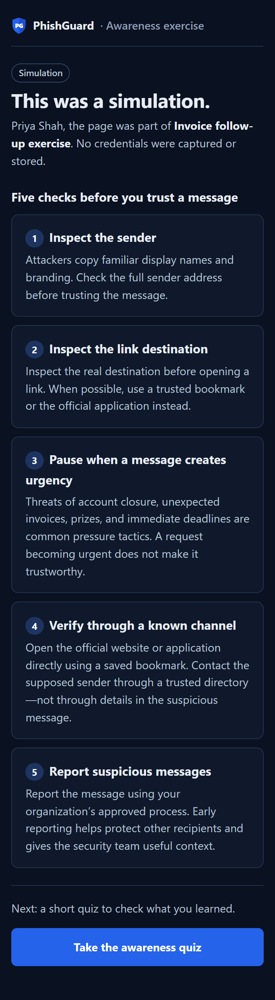

# PhishGuard Implementation Design and Model Evaluation

## Implementation

### Application architecture

PhishGuard combines controlled phishing simulations, awareness training and URL classification in a web application. Administrators use a React interface served by Vite during development. A Flask backend exposes JSON APIs for authentication, users, templates, campaigns, analytics, email delivery and URL detection. The participant simulation, training and quiz screens are rendered by Flask through token-based routes. This arrangement lets participants follow a campaign link without signing into the administrator workspace.

SQLAlchemy maps application records to relational database tables. The local working configuration uses SQLite, while the configuration also supports a PostgreSQL connection. Database selection is supplied through configuration. The Flask CLI loads a local environment file before constructing the application, allowing the same database and encryption configuration to persist across application restarts. Production hosting has not been established by the local implementation evidence.

The main records are administrators, users, email templates, sending profiles, campaigns, campaign recipients, tracking events, training results and quiz results. Each campaign references its creator and template. A campaign-recipient record joins a user to a campaign and contains a unique tracking token. A uniqueness constraint prevents duplicate assignments of the same user to the same campaign. Events and learning results reference this assignment, which keeps the participant's activity associated with the correct exercise. Training and quiz results each have a unique recipient reference.

### Administrator functions

Administrator authentication uses a password hash and a JSON Web Token. A successful login supplies the token required by protected management, analytics and detection endpoints. The frontend stores the session token for the browser session and returns the user to login when authorization expires. The password-change API checks the current password before saving a new hash. Administrator password values and Gmail application passwords have separate storage mechanisms and purposes.

The Users page provides a directory of participants and their departments. An administrator explicitly approves an address for simulation email. Approval is stored in the database and can be revoked through the interface. The Templates page provides creation, editing and deletion of message templates containing a name, subject, category and body. References to templates and users constrain deletion where necessary to preserve campaign history.

The Campaigns page lets an administrator select a template, choose a delivery method and assign recipients. The backend generates a cryptographically random tracking token for each assignment. Delivery preview presents the sender, subject, approved recipients, blocked recipients and readiness conditions. The administrator confirms the batch using the exact displayed phrase before sending.

### Simulation and learning workflow

The participant workflow proceeds from a recipient-specific tracking link to a controlled landing page, awareness material and a five-question quiz. Opening the tracking link records a click event. The landing page provides a simulated continuation action and records the corresponding interaction. The form avoids requesting or accepting credential values. The stored evidence consists of interaction types and timestamps.

Opening the training page records that the lesson was viewed and creates a training record if one does not already exist. The lesson presents checks that a participant can apply to suspicious messages. Quiz answers are scored on the backend. Completion stores the score, total question count and completion time, updates training completion, and records a quiz-completed event. These records support campaign reporting. A correct quiz result demonstrates immediate question performance; any claim about sustained learning would require additional participant evidence.

### Controlled email delivery

Mailpit supplies the local test inbox. It captures simulation emails so the message content and tracking flow can be exercised on the development machine. Personal Gmail delivery is available through one configured sending profile. Gmail uses authenticated SMTP with STARTTLS and certificate verification. Its application password is encrypted using Fernet, with the key supplied through local configuration. The application returns credential-configuration status in profile responses.

The delivery controls include recipient approval, an explicit delivery preview, typed confirmation and visible security-simulation labeling. Gmail campaigns require a configured public HTTPS tracking URL. Fixed limits restrict a campaign to ten pending recipients and twenty successful Gmail campaign deliveries per rolling hour. Successful-delivery records prevent a campaign from being resent to recipients already delivered. Partial failures retain successful records so a refreshed preview can identify the remaining recipients.

The Gmail coordination mechanism uses process-local locks. Its documented deployment constraint is a single backend process. Multiple workers would require shared coordination for the same delivery guarantees. These controls support authorized, limited awareness exercises and form part of the implementation's operating constraints.

### URL classification and explanations

The detector accepts a URL and calculates lexical features directly from its text. It performs no destination HTTP request, DNS lookup or page download. Nineteen features are extracted, covering lengths, character counts, hostname and path structure, suspicious terms, HTTPS usage, IP hosts, explicit ports, punycode, shorteners and character entropy.

The current classifier uses eighteen features. HTTPS usage is excluded from its inputs because the development sources differ substantially in their use of HTTPS, including the constructed HTTPS homepages derived from Tranco. Excluding this feature reduces one identified source cue. Other distribution differences remain possible.

The current Random Forest contains 400 trees, uses a maximum depth of eighteen and a minimum of two samples per leaf, applies balanced class weights and uses random seed 42. Its decision threshold is 0.5. The saved bundle records the feature order used by prediction. SHAP calculates feature contributions for an individual prediction, and the interface shows the five factors with the largest absolute impacts, their observed values and their direction. These factors describe how the fitted model arrived at a score. They do not establish the authenticity or safety of the destination.

### Analytics and risk calculation

The analytics endpoint aggregates campaigns, recipient assignments, interactions, training completion and quiz performance. Event types are deduplicated within each recipient assignment. Repeated clicks on a single recipient link therefore contribute one clicked assignment to the click-through count. Rates use recipient assignments as their denominator. A user assigned to two campaigns contributes two assignments to those measures.

The coaching score is calculated using explicit weights. A click contributes 25 points, simulated submission 45 points, incomplete training 20 points and the quiz knowledge gap up to ten points. A missing quiz contributes ten gap points. Scores are capped at 100. For users with multiple assignments, the displayed score is the rounded average of assignment scores. Low risk covers scores below 30, medium covers 30 to 59 and high covers 60 to 100. The score identifies follow-up priorities and should be interpreted in the context of the recorded exercise.

## Interface Design

### Design objectives and visual system

The implemented redesign uses a dark navy workspace, restrained blue accents, thin panel borders and light text. The PhishGuard wordmark and shield mark establish a consistent identity. Compact top navigation provides access to Overview, Users, Templates, Campaigns, Detection and Sending profiles. Account information and sign-out are grouped in an account menu.

The layout gives campaign evidence the largest central area. The summary row provides the campaign count, assignment count, clicks, training completion and quiz performance. Labels and denominators explain the scope of each value. The overview also retains the distinction between a measured zero and an absent quiz result.

### Dashboard information hierarchy

The overview presents three related views. Risk distribution shows the number of assessed people in each band. Campaign outcomes show assigned recipients, unique clicks, simulated submissions and training completions for the selected campaign. Coaching priorities order users by their risk score. The campaign selector allows the central view to change without altering the meaning of the overall summary.

Campaign outcomes use horizontal bars with a shared count scale and visible numeric labels. This supports comparison among measured outcomes. Each bar represents a separate count, since participants can enter training without completing every earlier simulated interaction. The coaching view pairs scores with written bands so that risk remains understandable without relying entirely on color. The detector similarly presents probability and explanation factors together to connect a prediction with the features that contributed to it.

### Responsive behavior and interaction

At narrower widths, the overview places campaign summary and outcomes first, followed by coaching priorities and risk distribution. Forms and participant pages use layouts appropriate to the available width. Navigation controls retain accessible names at tablet sizes. The administrator shell provides a skip link, focus management after page changes and an account menu that closes through Escape or an outside interaction.

Loading, empty, error and disabled states communicate whether an operation is progressing, requires input or cannot continue. Delivery warnings identify the relevant readiness condition before confirmation. Participant screens use the same visual language while concentrating on the immediate simulation, training or quiz task.

These are implemented design decisions. Their effectiveness for intended users will be assessed through the planned usability study. Participant testing is currently postponed, and satisfaction or task-success claims remain pending.

### Interface evidence

The following captured screens document the implemented redesign using demonstration data. They illustrate interface structure and flow. User-study outcomes will be recorded separately after participant sessions.

Figure 1. Administrator login using the redesigned visual system.

Figure 2. Overview with campaign outcomes, risk distribution and coaching priorities.

Figure 3. URL assessment with its displayed explanation factors.

Figure 4. Participant awareness content at a mobile viewport.

## Model Evaluation

### Evaluation purpose and frozen model

The final evaluation measured the current eighteen-feature classifier on a held-out sample whose source timestamps fall after an approved cutoff and whose normalized URLs and registrable domains were checked against the relevant historical raw data. The protocol specified the model, feature schema, threshold, source choices, cleaning, sample limits and sampling seed before final prediction. Collection and input-handling corrections were recorded in the evaluation history. The final run was executed on 26 November 2026 from code commit f696db3.

The evaluated artifact has SHA-256 checksum ac1dc5aac4d97333faea4bcf49a8323b55c49d9d7994db1a42f17c9f5cef9edc. The report records threshold 0.5, seed 42 and the eighteen ordered inputs. It also records source-file checksums and cleaning counts. These details connect the published result to the model, data preparation and code used for the run.

### Sources and meaning of the dates

Phishing examples came from a verified-online PhishTank snapshot downloaded on 22 November 2026. Legitimate candidates came from the October Common Crawl archive CC-MAIN-2026-43, using captures on an allowlist of 120 domains whose ownership had been checked against official registers. Candidate captures were restricted to successful HTML responses under the approved conversion rules.

The cutoff was 1 September 2026 at 00:00 UTC. For phishing rows, the relevant date is PhishTank's verification time. For legitimate rows, it is Common Crawl's capture time. Evaluated phishing timestamps range from September to November 2026, while legitimate captures fall between 5 and 18 October. These events establish source observation or verification after the cutoff. A page can have existed before its capture or verification date.

The historical legitimate archive has no per-URL dates. Direct overlap checks against its addresses and registrable domains therefore contribute to the holdout's separation. The earlier fifteen-feature dataset lacks original URLs and was explicitly excluded from the approved historical scope. This evaluation concerns the current raw-URL model.

### Cleaning and sample construction

Rows outside the model's accepted URL format were excluded during conversion and counted by reason. Eleven phishing rows were excluded for whitespace or length above 2,048 characters. Two of those were after the cutoff. Subsequent steps removed older timestamps, normalized duplicates, near-duplicate page templates, historical URL matches, historical registrable-domain matches and conflicting labels. A cap of twenty URLs per registrable domain limited concentration in individual sites. Balanced sampling selected 1,000 rows per class using seed 42.

| Cleaning stage | Phishing rows removed | Legitimate rows removed |
| --- | ---: | ---: |
| Unsupported input during conversion | 11 | 0 |
| Timestamp at or before cutoff | 39,560 | 0 |
| Exact duplicates after normalization | 48 | 0 |
| Near-duplicate page templates | 73 | 509 |
| Historical normalized URL matches | 7 | 0 |
| Historical registrable-domain matches | 445 | 0 |
| Conflicting labels | 0 | 0 |
| Twenty-per-domain cap | 0 | 734 |
| Sampling to 1,000 per class | 1,830 | 158 |

After cleaning and the domain cap, 2,830 phishing and 1,158 legitimate URLs remained. The evaluated sample contained 1,000 phishing URLs from 951 domains and 1,000 legitimate URLs from 76 domains. The reported overlap checks found no remaining shared historical hosts or page templates under their implemented definitions.

### Final results

| Actual class | Predicted legitimate | Predicted phishing | Total |
| --- | ---: | ---: | ---: |
| Legitimate | 892 | 108 | 1,000 |
| Phishing | 225 | 775 | 1,000 |
| Total | 1,117 | 883 | 2,000 |

Table 1. Final confusion matrix with phishing as the positive class.

| Metric | Final value |
| --- | ---: |
| Accuracy | 83.35% |
| Phishing precision | 87.77% |
| Phishing recall | 77.50% |
| Phishing F1 | 0.8232 |
| Legitimate precision | 79.86% |
| Legitimate recall | 89.20% |
| Legitimate F1 | 0.8427 |
| ROC-AUC | 0.8874 |
| PR-AUC using average precision | 0.9109 |

Table 2. Performance on the balanced final sample.

Accuracy is calculated as (892 + 775) / 2,000, giving 83.35%. Phishing recall is 775 / 1,000, so the detector identified 77.5% of the phishing examples and missed 22.5%. Phishing precision is 775 / (775 + 108), giving approximately 87.77%. This expresses how often a phishing warning was correct within this sample. F1 combines precision and recall through their harmonic mean. ROC-AUC summarizes score ranking across thresholds. PR-AUC was calculated using average precision with phishing as the positive class.

The 225 missed phishing URLs represent false negatives. The 108 legitimate URLs flagged as phishing represent false positives, giving a false-positive rate of 10.8% among the legitimate examples. These errors support presenting the detector as an aid to assessment. The evaluation counts the errors but does not establish their individual causes. Explanations based on unusually short phishing URLs or complex legitimate paths would require a separate error analysis.

### Relation to development results

The earlier fifteen-feature model achieved 89.24% accuracy on a random split of a 10,000-row feature dataset. Its later cross-source assessment achieved 48.29%. The current raw-URL model achieved 87.92% validation accuracy and 86.92% diagnostic accuracy before the final test. These evaluations used different samples, sources or model versions. They describe the development history and should not be treated as a controlled experiment isolating one improvement.

The current model's final accuracy of 83.35% is 4.57 percentage points below its recorded validation accuracy. The final protocol introduced later source timestamps, a different legitimate source and explicit overlap removal. These differences limit direct comparison and help explain why the held-out result is the relevant performance figure for the report.

### Validity and limitations

The balanced sample gives each class equal weight. It does not estimate the prevalence of phishing in everyday traffic. Precision depends on that prevalence, so the observed 87.77% phishing precision cannot be transferred directly to a population with a substantially different class mix.

The legitimate sample contains pages from official domains in Australia and the United States. It includes finance, education, health, non-profit, transport and utilities, and government sources. Shopping, social platforms, news and personal websites are outside this sampling frame. Finance, education and health contribute more examples than government and transport. Common Crawl coverage also limits which allowlisted domains yield eligible pages.

PhishTank contributes community-reported, verified phishing entries that were online at download time. Its coverage can omit unreported and short-lived attacks. Official-domain membership and a successful HTML capture are an operational legitimate-label rule, and compromised pages can still introduce label errors. Capture records do not expose every possible in-page redirect.

The classifier uses URL text only. It has no page-content, reputation or infrastructure evidence. Very long URLs and URLs containing whitespace fall outside the accepted input format. Historical separation depends on the recovered files and the implemented normalization, template and public-suffix rules. Changing attacker behavior can alter performance beyond this collection window. Future evaluation would require another independent sample and an explicitly recorded model version.

### Evaluation and study status

The final model evaluation and its aggregate report are complete. Participant usability testing is postponed. No participant task-completion rate, timing result, questionnaire average or claim about the redesign's ease of use is reported here. The prepared facilitator guide, questionnaire and analysis script support that later study.

## Repository Evidence

The sections above refer to the implementation and evidence present at main commit d9ce0c7. Chapter numbers can be assigned when the material is incorporated into the final report.

| Evidence | Repository location |
| --- | --- |
| Relational models | `backend/app/models.py` |
| Authentication | `backend/app/auth.py` |
| Simulation and training | `backend/app/simulation.py`, `backend/app/training.py` |
| Delivery implementation and operating constraints | `backend/app/email_delivery.py`, [delivery guide](safe_email_delivery.md) |
| Risk and campaign calculations | `backend/app/analytics.py`, [dashboard guide](phase6_dashboard.md) |
| Administrator shell and overview | `frontend/src/pages/Dashboard.jsx`, `frontend/src/pages/Overview.jsx` |
| Feature extraction and current training | `backend/app/ml/features.py`, `backend/app/ml/retrain_raw.py` |
| Prediction and SHAP | `backend/app/ml/service.py` |
| Final aggregate report | [recorded evaluation](../ml_model/artifacts/final_untouched_evaluation.json) |
| Protocol and source documentation | [evaluation plan](final_model_evaluation_plan.md), `ml_model/final_evaluation/` |
| Evaluation history and discussion | [ML guide](phase5_ml_detection.md) |
| Redesigned interface captures | `docs/evidence/redesign/` |
| Deferred usability study | [study guide](usability_testing_guide.md) |

Repository evidence supports the implementation statements and numerical results. Literature citations and required chapter formatting should follow the final report's institutional template.
